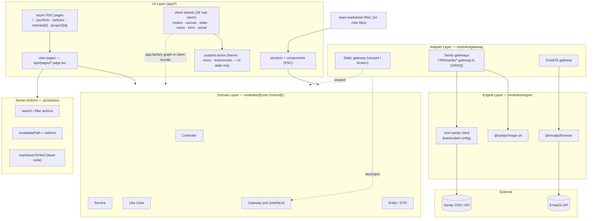
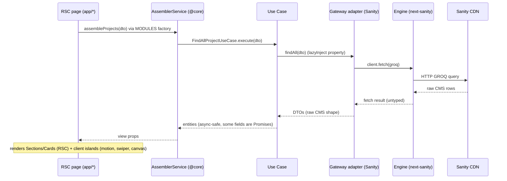
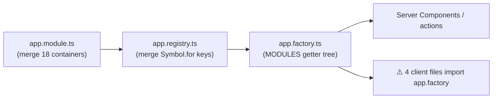

# 01 · Architecture

> Layered, hexagonal-flavored architecture with per-domain modules and Inversify-driven dependency injection, embedded in Next.js 14 App Router Server Components.

**Priority tags:** 🔴 P0 · 🟠 P1 · 🟡 P2 — see [README](README.md) legend.

## Table of Contents

1. [Overview & Classification](#1-overview--classification)
2. [Routing](#2-routing)
3. [Data Flow](#3-data-flow)
4. [Rendering Strategy](#4-rendering-strategy)
5. [Dependency Injection Pattern](#5-dependency-injection-pattern)
6. [Content Architecture](#6-content-architecture)
7. [Risks & Technical Debt](#7-risks--technical-debt)
8. [ADR Suggestions](#8-adr-suggestions)

---

## 1. Overview & Classification

The codebase enforces a strict 6-layer flow per domain (`src/modules/@core/*`), fronted by async Server Components that resolve services through factory functions:

```
RSC Page (app/*) → View page (app/pages/*.page.tsx) → Controller → Service → Use Case → Gateway (port)
                                                                                          ↓
                                                    lazyInject (gateway.module.ts) ← Adapter → Engine → External SDK
```

### Dependency flow



### Layer inventory

| Layer | Path | Contents |
|---|---|---|
| Presentation / Routing | `src/app/*`, `src/app/pages/*` | Thin async RSC pages + async view "pages" + home sections |
| Client UI + local state | `src/components/*`, `src/hooks/*` | 28 `'use client'` components; zustand stores (theme, menu, testimonial) |
| Domain (ports & logic) | `src/modules/@core/*` | 12 domains (article, project, tech, person, occupations, highlight, experience, company, platform, testimonial, email, assembler); each with `controller/ service/ use_case/ gateway/ entity/ DTO/` |
| Adapters | `src/modules/gateway/*` | `CMS/sanity/*.gateway.ts` (GROQ), `mailer/emailjs/*`, `CMS/static/*` (fallback, currently unused) |
| Engines (SDK wrappers) | `src/modules/engine/*` | next-sanity client + image builder, EmailJS init |
| Config / Validation | `src/modules/@config`, `src/modules/validation` | env config; zod schemas (react-hook-form) |
| Server actions | `src/actions/*` | search filter, `revalidatePath` + redirect, markdown→HTML (unused) |
| CMS authoring | `sanity/*`, `sanity.config.ts` | Sanity Studio schemas, embedded Studio route `/sanity/studio` |

### Layering observations

- **Ports only in `@core`** — e.g. `IArticleGateway` in `@core/articles/gateway/article.gateway.ts`; adapters implement those interfaces. Adapter selection happens via `injectGateway` — a `lazyInject` from `inversify-inject-decorators` bound to the merged `GATEWAY_MODULE`. This is genuine hexagonal thinking and the strongest part of the design.
- **Inversion of control is real but expensive** — each domain needs 5–7 boilerplate files (module/registry/factory/controller/service/use_case/DTO/entity). 12 domains ≈ 90+ infrastructure files for ~30 actual operations. The `controller → service → use case` chain is pure pass-through, adding no behavior.
- **Zustand is NOT between UI and services** — it holds only UI state (`theme`, `menu`, testimonial selection). All domain data flows RSC → Inversify graph.
- **Client/server boundary leakage 🔴 P1** — 4 client files import `@/modules/app.factory` (`src/hooks/animation/animation.hook.ts`, `src/components/social/social.component.tsx`, `src/components/navigation/menu/container/container.component.tsx`, `src/components/section/contact/form/fields/fields.component.tsx`). Because `app.factory.ts` re-exports *all* domain factories/registries, the **entire Inversify graph (Sanity client, EmailJS, zod, all modules) is pulled into the browser bundle**.

## 2. Routing

App Router only — `src/pages/` is an **empty dead folder** (Pages Router never used). 9 route files (verified in the project structure map):

| Route | File | Type | Data source | Cache / Revalidation |
|---|---|---|---|---|
| `/` | `src/app/page.tsx` | RSC async; 10 sections each call MODULES | Sanity (assembler per section) | No `revalidate`, no tags |
| `/portfolio` | `src/app/portfolio/page.tsx` | RSC async, reads `searchParams` | Sanity + `filterPortfolio` | Dynamic every request (searchParams) |
| `/articles` | `src/app/articles/page.tsx` | RSC async, reads `searchParams` | Sanity + `filterArticles` | Dynamic every request (searchParams) |
| `/article/[id]` | `src/app/article/[id]/page.tsx` | RSC async, `params.id` | Sanity `findOneByTitle` | No `generateStaticParams` |
| `/project/[id]` | `src/app/project/[id]/page.tsx` | RSC async, `params.id` | Sanity `findOneProjectByTitle` | No `generateStaticParams` |
| `/jobs` | `src/app/jobs/page.tsx` | RSC static placeholder | — | Static |
| `/journey` | `src/app/journey/page.tsx` | RSC static placeholder | — | Static |
| `/my/world` | `src/app/my/world/page.tsx` | RSC static placeholder | — | Static |
| `/sanity/studio/[[...index]]` | `src/app/sanity/studio/[[...index]]/page.tsx` | Client | — | Client-only |

Non-route surfaces: view components inside `src/app/pages/*` (`projects.page.tsx`, `articles.page.tsx`, `showroom/*`, `under_development.page.tsx`, `missing_data.page.tsx` — the latter is **dead**, never imported). No API routes, no middleware, no `loading.tsx` / `error.tsx` / `not-found.tsx` anywhere.

> ⚠️ **Composition quirk:** `src/app/pages/` lives *inside* `app/` but contains UI view components, not router files — unconventional placement that confuses Next conventions.

## 3. Data Flow



**Critical data-path facts:**

- **Sanity is invisible to Next's data cache.** Data is fetched via next-sanity `client.fetch` (not the instrumented global `fetch`). The engine client hardcodes `useCdn: true` — caching is delegated entirely to Sanity's CDN with **no revalidation hook** into the RSC render.
- **Async entities leak promises as state 🔴 P0.** `Project.entity` fields are `description: string | Promise<string>` and `techs: Promise<Tech>[]`; `sync()`/`toView()` await them, but `toDTO()` casts `this._description as string` — an unsound cast.
- **N+1 GROQ fan-out.** Identifier-based joins fire `1 + N` separate queries per list item (title, description, content, techs, platforms) — each uncached per request. The per-item lookups are array-mapped rather than `Promise.all`'d at gateway level in several spots.

## 4. Rendering Strategy

### Server vs. client split

- **Server Components (async RSC):** all 8 content routes + view pages + sections + navbar/hero — data flows RSC → MODULES → Sanity.
- **Client Components (28 files):** `components/motion/*`, `components/canvas/*`, `components/slider/*`, `components/navigation/menu/*`, `components/wrapper/*` (theme, testimonial select), contact form fields, `components/social/*`, `components/card/testimony/*`, `hooks/animation/*`, and the embedded Studio route.

### Findings

1. **No explicit caching strategy anywhere 🔴.** `next.config.mjs` contains no `experimental`, `output`, or revalidation settings. Grep across `src/` finds zero `export const revalidate`, zero `generateStaticParams`, zero `next: { revalidate }`, zero `unstable_noStore`/`force-dynamic`.
2. **Inconsistent route behavior.** `searchParams`-based routes (`/portfolio`, `/articles`) render dynamically per request and re-query Sanity each time; the other routes have no dynamic API and are **prerendered at build time by Next** (SSG with build-era content). Result: home/articles-detail pages may serve *frozen* content while listing pages serve *live* content — a freshness split that can surprise after CMS edits, with no webhook to reconcile.
3. **Server actions used for navigation filters** (`revalidatePath` + `redirect` on every search form submit, `src/actions/search/search.action.ts`) — heavyweight pattern for a client-side filter that re-renders the full page server-side to apply an in-memory `.filter()`.
4. **No `loading.tsx`, `error.tsx`, or custom `not-found.tsx`** — detail pages `redirect('/not-found')` to the default 404 (B4).
5. **No `generateMetadata`** on dynamic pages (SEO titles/descriptions default), no `sitemap.ts`, no `robots.ts`, no per-page OG images.

### Recommended posture (see [06-roadmap.md](06-roadmap.md) P1)

```ts
// Pattern to adopt on content routes
export const revalidate = 3600; // or use tag-based revalidation via a Sanity webhook
```

```ts
// Pattern to adopt on dynamic routes
export async function generateStaticParams() { /* GROQ fetch of ids/titles */ }
export const dynamicParams = false; // 404 unknown paths at request time
```

## 5. Dependency Injection Pattern

Inversify IoC via `experimentalDecorators` + `emitDecoratorMetadata`; `reflect-metadata` imported in `app.module.ts` and `gateway.module.ts`.



**The pattern (4 artifacts per bounded context):**

1. **Registry** — `Symbol.for` keys: `src/modules/@core/project/project.registry.ts`
2. **Module** — Inversify `Container` + explicit binds (`defaultScope: 'Singleton'`, `autoBindInjectable: true`): `src/modules/@core/project/project.module.ts`
3. **Factory** — typed getter tree `MODULES.X.Y()`: `src/modules/@core/project/project.factory.ts`
4. **Aggregation** — `app.module.ts` merges 18 containers; `app.registry.ts` merges registries; `app.factory.ts` merges factories → single `MODULES` export consumed everywhere.

**Property injection (lazyInject):** gateway/support classes avoid constructor-injection cycles:

```ts
// src/modules/gateway/gateway.module.ts
export const { lazyInject: injectGateway } = lazy(GATEWAY_MODULE);

// src/modules/@core/person/gateway/gateway.support.ts
@injectGateway(MODULE.GATEWAY.CMS.SANITY.PERSON) protected readonly gateway: IPersonGateway;
```

**Engine layer** binds concrete adapters as constants/dynamic values — `SANITY` as `toConstantValue`, `SANITY_IMAGE_BUILDER` as `toDynamicValue(...).inSingletonScope()`.

**Assessment:** Inversify is used meaningfully and with discipline (singleton scopes, typed symbols, lego-style assembly), but at a cost: ~18 modules / ~90 DI files for a portfolio, factory calls scattered through server components, and a broken half-built static fallback lane (see [02-implementation.md](02-implementation.md) §5).

## 6. Content Architecture

### Sanity schemas → UI mapping (18 types)

| Schema (file) | Type name | Purpose / UI consumption |
|---|---|---|
| `person.schema.ts` | `person` | Hero card, about, testimonial author, contact |
| `typography/title.schema.ts` | `title` | Localized heading strings (identifier + lang lookup) |
| `typography/text.schema.ts` | `tp_text` | Localized body copy (identifier + lang lookup) |
| `sections/home/hero.schema.ts` | `home_hero` | Hero section aggregate (title/person/description refs) |
| `sections/home/hero/occupations.schema.tsx` | `occupations` | Hero occupation list |
| `item/tech.schema.ts` | `tech` | Techs section + project tech chips |
| `item/project.schema.ts` | `project` | Portfolio cards + `/project/[id]` showroom |
| `item/article.schema.ts` | `article` | Articles shelf + `/article/[id]` |
| `item/platform.schema.ts` | `platform` | Article external platform links |
| `item/company.schema.ts` | `company` | Experience company refs |
| `item/experience.schema.ts` | `experience` | Career/academic timeline |
| `item/hightlight.schema.ts` | `hightlight` | Stats/numbers section (type name + `positon` field misspelled) |
| `testimonial.schema.ts` | `testimonial` | Testimonials carousel |
| `navbar.schema.ts` | `navbar` | Nav menu items |
| `contact.schema.ts` | `contact` | Contact links |
| `lang.schema.ts` | `lang` | Language vocabulary (name, code) |
| `file.schema.ts` | `app_file` | Downloadable files |
| `image.schema.ts` | `image` | Image document |

### Identifier-based joins (by convention, not reference)

The dominant pattern is **indirection via string identifiers** instead of real Sanity references:

1. `project.description`, `article.title`, `article.description`, `article.content` store **strings that are actually identifiers** of `tp_text`/`title` documents.
2. Adapters resolve them with extra GROQ queries (e.g. `SanityArticleGateway.build()`: +1 query for title, +1 for description, +1 for content, +1 × N per platform ref).
3. **Cost 🔴:** every list page fires 10–20 sequential-ish GROQ round trips; each runs uncached per request.

### GROQ hygiene — security & correctness

- **String interpolation 🔴 P0.** Adapters interpolate user/URL values into GROQ literals: `*[_type == "title" && identifier == "${article.title}"]`. `title` originates from the URL (`/article/[id]`, decoded) — injection-prone query construction (no parameter binding). Feasible abuse: query distortion/DoS, reading fields not otherwise projected.
- **Typo bug 🔴 P0 (B2).** `SanityArticleGateway.findMainArticles()` projects `plarforms` (`article.gateway.ts:66`) — main articles on the home slider silently lose their platform links.
- **Inconsistent practice.** `findOneByTitle` for projects uses parameterized `$title` correctly (`project.gateway.ts:89`), but the identifier resolutions around it are still interpolated.

### Markdown handling

- **No `.mdx` files exist**; `next-mdx-remote@4` is installed but **never imported**.
- Article content is rendered by `src/components/markdown/markdown.component.tsx` — an async RSC wrapping `react-markdown` with `remark-gfm`, **`rehype-raw`** (raw HTML passthrough), and `rehype-highlight`.
- `rehype-raw` + CMS content = **XSS surface 🔴 P0** (defense-in-depth concern; content is editor-controlled but unconstrained). The sanitizer that would mitigate this, `markdownToHtml` (`src/actions/markdown.action.ts`, remark-html + DOMPurify + jsdom), is **dead code — never called**.

## 7. Risks & Technical Debt

### Main risks (R1–R8)

| # | Risk | Severity | Impact | Location |
|---|---|---|---|---|
| R1 | Zero automated tests: 0 Jest specs, 0 Cypress specs; `--passWithNoTests` and empty coverage make `code:ci` a green-wash | 🔴 **High** | Regressions (B1/B2 class) ship silently | `package.json` scripts, `jest.config.ts`, `cypress/` |
| R2 | No caching/revalidation strategy → route-to-route freshness split & per-request N+1 Sanity calls | 🔴 **High** | Slow TTFB, stale content after CMS edits, quota burn | `next.config.mjs`, all gateways |
| R3 | GROQ string interpolation (URL-derived values) | 🔴 **High** | Query injection — data distortion/read beyond intent | article/project/tech gateways |
| R4 | Whole Inversify graph shipped to browser via 4 client files importing `app.factory` | 🟠 **Medium** | Bundle bloat; decorator metadata + all modules in client | `src/hooks/animation/animation.hook.ts` et al. |
| R5 | Two divergent Sanity clients; hardcoded `projectId`/`dataset` in source | 🟠 **Medium** | Config drift, env-broken setups, credential hygiene | `sanity/lib/client.ts` vs `engine/CMS/sanity/sanity.engine.ts` |
| R6 | `zustand@5.0.0-rc.2` pinned | 🟠 **Medium** | Unstable API surface; upgrade drift | `package.json` |
| R7 | `next-sanity@7` older major; `sanity@3.25` | 🟠 **Medium** | Deprecated APIs, narrowing upgrade corridor to Next 15/SDK v4 | `package.json` |
| R8 | `rehype-raw` XSS surface (mitigation action dead) | 🟠 **Medium** | Stored XSS if CMS account compromised | `markdown.component.tsx`, `markdown.action.ts` |

### Additional risks (R9–R14)

| # | Risk | Severity | Impact | Location |
|---|---|---|---|---|
| R9 | Type safety off (`strict: false`), invalid eslint rule `"scape-case"`, `ignoreDuringBuilds: true` | 🟠 **Medium** | Class of bugs (typos, `any`) unreported | `tsconfig.json`, `.eslintrc.json`, `next.config.mjs` |
| R10 | `eslint-config-next@14.1.0` vs `next@14.2.10` mismatch | 🟡 Low-Med | Lint behavior divergence | `package.json` |
| R11 | EmailJS direct-from-browser sends, no rate limiting/server relay | 🟡 Low-Med | Spam abuse of the contact form | `fields.component.tsx`, `email.hook.ts` |
| R12 | Unused subsystems (static gateways, `sanity/lib`, actions, 5 deps) | 🟡 Low | Confusion, maintenance tax, install bloat | §6, [02-implementation.md](02-implementation.md) §7 |
| R13 | `images.remotePatterns` allows any `https` host | 🟡 Low | Image optimization abuse surface | `next.config.mjs:7-12` |
| R14 | react-i18next absent usage + `html lang="en"` hardcoded while CMS has `lang` fields | 🟡 Low | i18n capability implied but not wired | `layout.tsx`, schemas |

### Known functional bugs (B1–B6)

| # | Bug | Severity | Location |
|---|---|---|---|
| B1 | `{main.map(async project => …)}` — array of un-awaited Promises rendered as children; main-project slider can fail/no-op | 🔴 P0 | `src/app/pages/projects/projects.page.tsx:22` |
| B2 | GROQ projection typo `plarforms` — main articles lose platform links | 🔴 P0 | `article.gateway.ts:66` |
| B3 | String-interpolated GROQ identifiers with URL-derived values ($injection) | 🔴 P0 | article + project gateways (multiple lines) |
| B4 | `redirect('/not-found')` without custom `not-found` boundary — default 404, no UX | 🟠 P1 | `shelf/article.page.tsx:13`, `showroom.page.tsx:16` |
| B5 | Dockerfile has no `CMD` (production start commented out) + `docker-compose.yaml` runs **dev server** | ❌ P0 | `Dockerfile:12`, `docker-compose.yaml:6` |
| B6 | `rehype-raw` renders raw HTML from CMS content; the DOMPurify sanitizer action exists but is unused | 🔴 P0 | `components/markdown/markdown.component.tsx:3` |

### Additional bugs from implementation review

| # | Bug | Location |
|---|---|---|
| B7 | Wrong binding key — `STATIC.FIND.ALL` bound twice, `STATIC.FIND.ONE` never bound | `person.module.ts:260` |
| B8 | `StaticPersonGateway.findOne` — async predicate in `.find()` always truthy → returns first person | `gateway/CMS/static/person/person.gateway.ts` |
| B9 | `StaticAssemblerService` — 8 methods declared as uninitialized class fields, never implemented | `@core/assembler/service/static/assembler.service.ts` |
| B10 | `UnderDevelopmentPage` — `Math.random()` in server render (hydration mismatch risk) + hotlinked giphy images | `src/app/pages/under_development.page.tsx` |
| B11 | `Slider` receives `children.map(async …)` promises from the server page and keys slides by `child?.toString()` — fragile serialization assumption | `projects.page.tsx` → `slider/slider.component.tsx` |

## 8. ADR Suggestions

None exist in the repo today — the *de facto* architecture is encoded only in directory structure. Recommended records:

| ADR | Decision to capture | Why | Cost to accept |
|---|---|---|---|
| ADR-001 | **DI strategy** — Inversify + factory/registry pattern, singleton containers, `lazyInject` property injection | Chosen for testability/CMS-swap; the strongest part of the codebase | Boilerplate (~90 files) + client-bundle coupling (R4) — mitigate by narrowing client imports |
| ADR-002 | **Rendering/caching strategy** — currently implicit; must become explicit (ISR vs dynamic vs SSG per route; tag-based revalidation via Sanity webhook) | Fixes R2 freshness split and quota burn | `revalidate`/`generateStaticParams` per route + webhook route handler |
| ADR-003 | **CMS adapter pattern** — identifier-based joins, single Sanity client, parameterized GROQ, join-first queries | Standardizes gateway code, kills N+1 and injection (R2/R3) | Refactor of article/project/tech gateways + contract tests |
| ADR-004 | **i18n scope decision** — implement react-i18next (App Router per-request pattern) or remove it | Today it is dead weight with implied-but-unwired multilingual capability (R14) | Either the [locale] SSR pattern or a dependency-removal PR |

---

## Quick links

- Parent: [README.md](README.md) · Index: [docs/README.md](README.md)
- Next: [02 · Implementation](02-implementation.md) · [03 · Quality & Security](03-quality-security.md)
- Act: [06 · Roadmap](06-roadmap.md) (P0 items 1–6 map to findings above) · [07 · References](07-references.md)